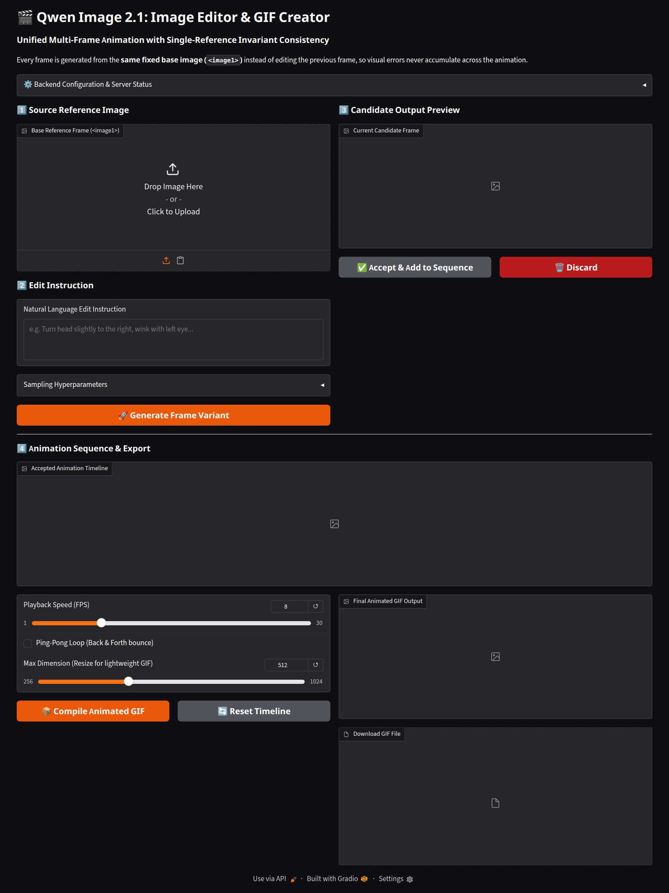
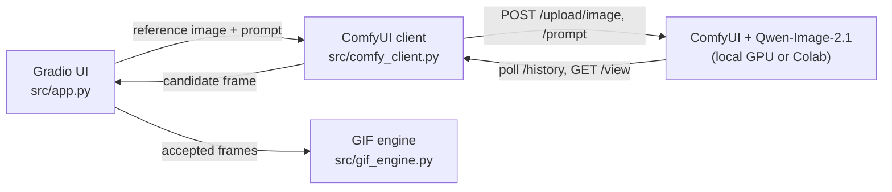

# Qwen-Image-2.1 GIF Creator

[](https://www.python.org/downloads/)
[](https://github.com/astral-sh/uv)
[](https://gradio.app/)
[](LICENSE)

A Gradio app that turns one photo into an animated GIF. You describe each frame in plain language ("turn the head to the right", "smile"), [Qwen-Image-2.1](https://github.com/QwenLM/Qwen-Image-2.1) edits the photo through a ComfyUI backend, and Pillow assembles the frames you keep into an optimized GIF.



## The idea: never edit an edit

The naive way to animate with an image editor is to chain it: edit frame 1 to get frame 2, edit frame 2 to get frame 3, and so on. Every pass adds a little diffusion noise, so faces, textures and backgrounds drift and degrade within a few frames.

This app uses a **single fixed reference** instead. Every frame is generated from the **original** photo (`<image1>`) with a different instruction:

```
                 ┌─► "slight smile"          ─► frame 1 ─┐
original photo ──┼─► "big smile, head right" ─► frame 2 ─┼─► Pillow ─► animated GIF
   (<image1>)    └─► "back to neutral"       ─► frame 3 ─┘
```

Errors never compound, because no frame is built on top of another.

## How it works



- **`src/comfy_client.py`**: uploads the reference image, fills the `workflow_api.json` template, queues it, polls until it finishes and downloads the result. It finds nodes by type (`LoadImage`, `TextEncodeQwenImage21`, `KSampler`), not by hard-coded IDs, so a graph re-exported from ComfyUI still works. ComfyUI execution errors (a missing weight file, for example) are reported right away instead of after the timeout.
- **`src/gif_engine.py`**: normalizes frame sizes, optionally downscales, adds a ping-pong (boomerang) loop and quantizes each frame to an adaptive 256-color palette.
- **`src/app.py`**: the review loop. Generate a candidate, accept or discard it, then compile the accepted frames.
- **`workflow_api.json`**: the official Qwen-Image-2.1 *image edit* graph in ComfyUI API format (`UNETLoader` + `CLIPLoader` + `VAELoader` + `TextEncodeQwenImage21` + `KSampler`, cfg 1, euler/simple), without the optional prompt enhancer.

## Quick start

Requires [uv](https://docs.astral.sh/uv/).

```bash
uv sync
cp .env.example .env      # set COMFYUI_URL if your backend is not on 127.0.0.1:8188
uv run python main.py     # http://localhost:7860
```

The UI works without a backend. You need ComfyUI with Qwen-Image-2.1 to generate frames.

## Backend: ComfyUI + Qwen-Image-2.1

You can run the backend on your own GPU or on Colab.

**Option A: Google Colab.** Open [`notebooks/qwen_image_colab_tutorial.ipynb`](notebooks/qwen_image_colab_tutorial.ipynb) in Colab. It installs ComfyUI, downloads the weights, and opens a Cloudflare tunnel. Paste the tunnel URL into **Backend Configuration** in the app.

**Option B: local GPU.** Install [ComfyUI](https://github.com/comfyanonymous/ComfyUI) **0.37.0 or newer**, download these files from [`Comfy-Org/Qwen-Image-2.1`](https://huggingface.co/Comfy-Org/Qwen-Image-2.1), and start it with `python main.py --listen`.

| File | Folder | Size |
| --- | --- | --- |
| `qwen_image_2.1_int8_convrot.safetensors` | `models/diffusion_models/` | 6.8 GB |
| `qwen3vl_8b_int8_convrot.safetensors` | `models/text_encoders/` | 8.7 GB |
| `qwen_image_2.1_vae_bf16.safetensors` | `models/vae/` | 0.6 GB |

The `*_bf16` variants give higher quality on larger GPUs. If you use them, update the file names in `workflow_api.json`.

### Generation settings

| Setting | Default | Notes |
| --- | --- | --- |
| Steps | 25 | The official pipeline uses 40-50 with euler. 25 is a faster default. |
| Edit resolution | 1024 | Total pixel budget, not width or height. The model supports up to 2048. |
| Seed | random | Set a fixed seed to reproduce a frame. |

Prompts refer to the reference image as `<image1>`. The client adds the tag automatically if you leave it out.

## Development

```bash
uv run pytest -v          # unit tests (ComfyUI HTTP calls are mocked; no GPU needed)
uv run ruff check .
uv run ruff format --check .
```

## Project structure

```
├── main.py                 # entry point
├── workflow_api.json       # Qwen-Image-2.1 edit graph (ComfyUI API format)
├── src/
│   ├── app.py              # Gradio UI and timeline state
│   ├── comfy_client.py     # ComfyUI REST client
│   └── gif_engine.py       # GIF assembly with Pillow
├── tests/                  # pytest suite
└── notebooks/              # Colab backend setup
```

## Limitations

- Generation quality depends on the prompt. Small, concrete changes ("tilt the head slightly left") animate better than big scene changes.
- Each frame is an independent edit, so consecutive frames are not interpolated. Use more frames or a higher FPS for smoother motion.
- The tests cover the client and the GIF engine with mocked HTTP. Running an actual generation needs a GPU backend.

## License

The code is MIT-licensed (see [LICENSE](LICENSE)). The Qwen-Image-2.1 weights are distributed separately under the **Qwen Research License**. Check its terms before any commercial use.
