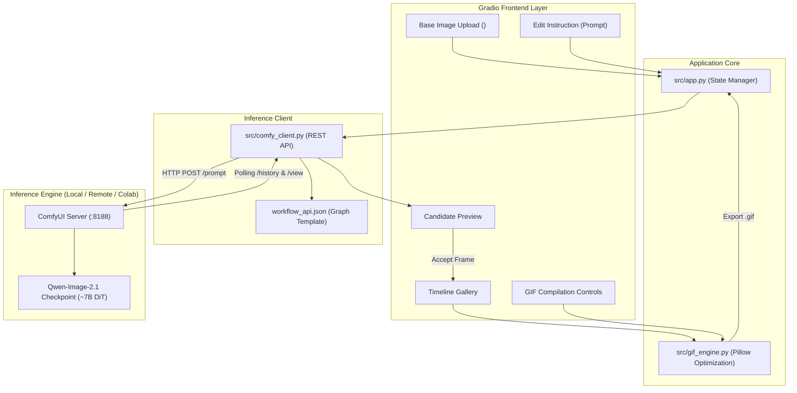

# 🎬 Qwen-Image-2.1: Image Editor & Animated GIF Creator

[](https://www.python.org/downloads/)
[](https://github.com/astral-sh/uv)
[](https://gradio.app/)
[](LICENSE)

> **An interactive web studio and technical tutorial demonstrating multi-frame AI character animation using Alibaba's Qwen-Image-2.1, ComfyUI, and Pillow.**  
> *Authored by Juan Jose*

---

## 📖 Theoretical Foundation & Core Problem

Generating sequential animation frames or dynamic GIFs using generative diffusion models typically presents a critical technical hurdle known as **Cumulative Visual Degradation**.

### The Problem: Recursive Chaining
In a naive recursive approach, each newly generated frame $F_{t}$ is fed as the input image to synthesize $F_{t+1}$:

```
Base Image F0 ──► Edit 1 ──► Frame F1 ──► Edit 2 ──► Frame F2 ──► Edit 3 ──► Frame F3 (Artifacts accumulated)
```

With each generation step, diffusion noise and minor anatomical distortions compound. By frame 3 or 4, facial structures, textures, and background elements suffer from severe hallucination and degeneration.

### The Solution: Single-Reference Invariant Architecture
This project implements the **Single-Reference Invariant Pattern**. Rather than chaining frames recursively, **the original base image $F_{0}$ remains permanently anchored** as the sole reference input (`<image1>`):

```
                       ┌──► Prompt 1 ──► Candidate F1 (Pose 1)
                       │
Base Reference Frame F0 ──► Prompt 2 ──► Candidate F2 (Pose 2) ──► Assemble with Pillow ──► Animated GIF
                       │
                       └──► Prompt 3 ──► Candidate F3 (Pose 3)
```

Every candidate frame preserves pristine background fidelity, consistent clothing details, and uniform lighting, yielding fluid, artifact-free animated loops.

---

## 🏛️ System Architecture



---

## ✨ Features

- **Decoupled Architecture:** Clean client-server separation. The Python UI runs locally in milliseconds, communicating with any ComfyUI instance (local machine, Google Colab, or cloud GPU).
- **Interactive Staging Workflow:**
  1. Inspect generated candidates in a dedicated comparison viewer.
  2. Selectively **Accept** frames into the timeline or **Discard** unwanted variations.
  3. Real-time timeline gallery showing the sequence progression.
- **High-Performance GIF Engine (`src/gif_engine.py`):**
  - **Adaptive Color Quantization:** 256-color adaptive palette conversion prevents GIF dithering artifacts.
  - **Ping-Pong Loop Mode:** Seamless back-and-forth bounce animation.
  - **Granular FPS Control:** Configurable frame durations (1 to 30 FPS).
  - **Proportional Downscaling:** Optional dimension capping for Discord/web-friendly file sizes.
- **Full Type Safety & Unit Testing:** Built with Python 3.12, strict type hints, and 100% test coverage on critical utilities.

---

## 📁 Repository Structure

```
example-projects/
├── notebooks/
│   └── qwen_image_colab_tutorial.ipynb  # Ready-to-run Google Colab workflow
├── src/
│   ├── __init__.py
│   ├── app.py                          # Gradio UI & timeline state management
│   ├── comfy_client.py                 # REST client for ComfyUI API
│   └── gif_engine.py                   # Pillow animation assembly & optimization
├── tests/
│   ├── __init__.py
│   ├── test_comfy_client.py            # Unit tests for ComfyUI payload injection
│   └── test_gif_engine.py              # Unit tests for GIF creation & transformations
├── workflow_api.json                   # Exported ComfyUI graph for Qwen-Image-2.1
├── main.py                             # Application entrypoint
├── pyproject.toml                      # Project metadata & dependencies (uv)
├── .python-version                     # Python 3.12 pinning
├── .env.example                        # Environment variables template
└── README.md                           # Documentation & technical guide
```

---

## 🚀 Getting Started

### 1. Prerequisites
Ensure you have [`uv`](https://docs.astral.sh/uv/) installed:
```bash
# On Linux / macOS:
curl -LsSf https://astral.sh/uv/install.sh | sh
```

### 2. Installation
Clone this repository and install dependencies inside a sandboxed virtual environment:
```bash
# Synchronize environment and install dependencies
uv sync
```

### 3. Configuration
Copy the sample environment file:
```bash
cp .env.example .env
```

Configure your ComfyUI address in `.env` (default is `http://127.0.0.1:8188`):
```ini
COMFYUI_URL=http://127.0.0.1:8188
PORT=7860
HOST=0.0.0.0
```

---

## 💻 Running the Application

Launch the local web server:
```bash
uv run python main.py
```

Open your browser at `http://localhost:7860`.

### Connecting to GPU Inference:
1. **Local ComfyUI:** If you have an NVIDIA GPU with 16GB+ VRAM, launch ComfyUI locally with `--listen 0.0.0.0`.
2. **Google Colab (Free or Pro):** Open [`notebooks/qwen_image_colab_tutorial.ipynb`](notebooks/qwen_image_colab_tutorial.ipynb) in Colab. Run the ComfyUI background cell and Cloudflare tunnel, then paste the public URL into the **Backend Configuration** section in the Gradio web UI.

---

## 🧪 Testing & Code Quality

Run automated unit tests:
```bash
uv run pytest -v
```

Run code formatting and linting checks:
```bash
uv run ruff check .
```

---

## 🗺️ Roadmap & Extensions

- [ ] **Gradio Client / Hugging Face Spaces Bridge:** Add direct connector to public Hugging Face ZeroGPU demos without self-hosting ComfyUI.
- [ ] **Latent Blending / Frame Interpolation:** Implement RIFE or frame morphing between adjacent keyframes for 60 FPS ultra-smooth playback.
- [ ] **Interactive Mask Inpainting:** Add canvas drawing tools in Gradio to isolate specific editing regions (e.g. modifying only the subject's hand or mouth).

---

## 📄 License
This project is open-source under the [MIT License](LICENSE).
